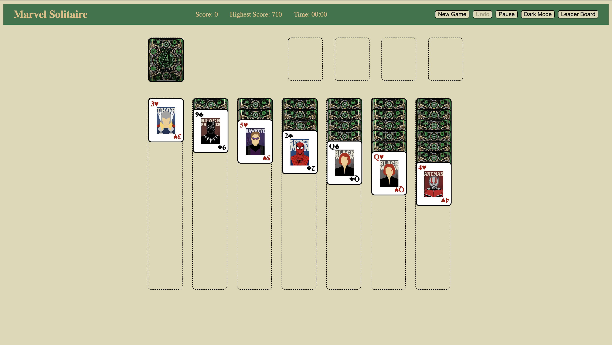
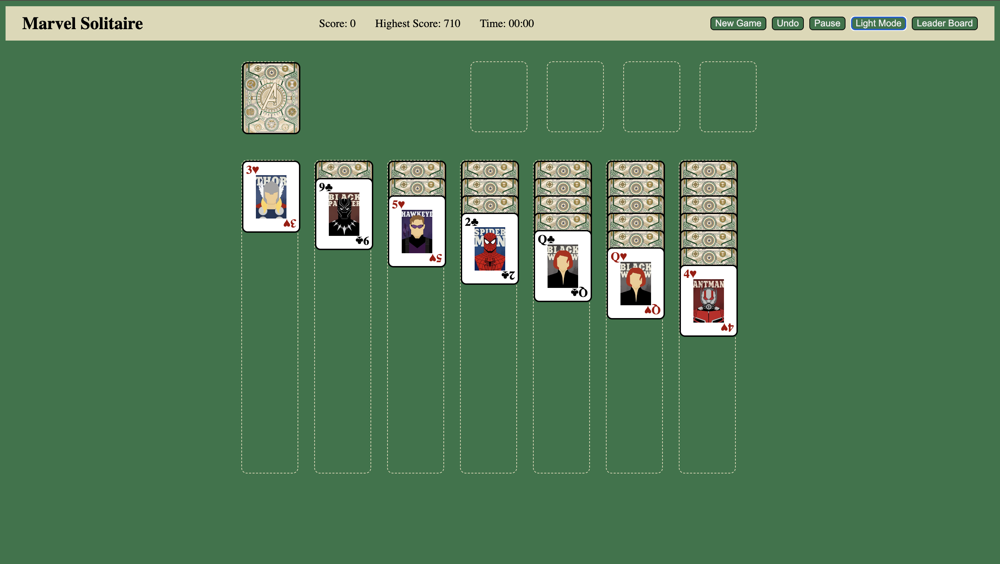
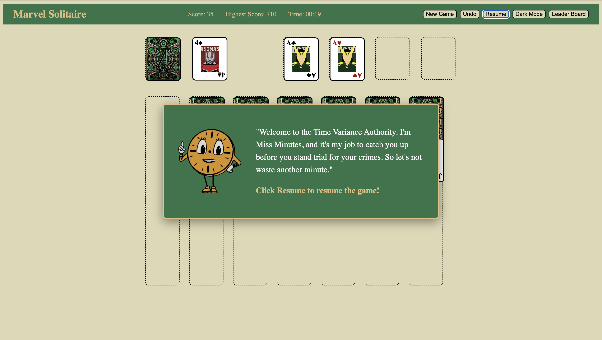
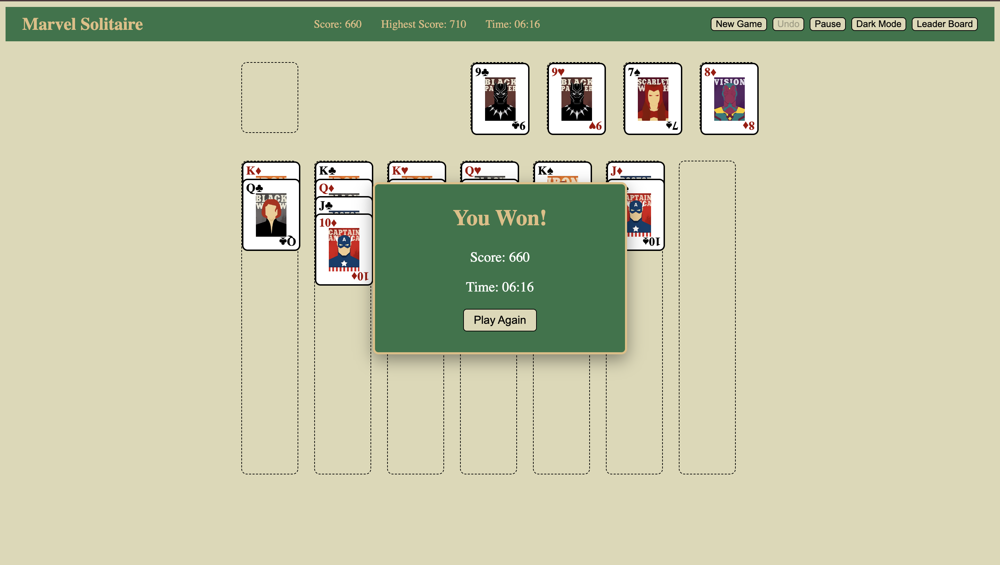
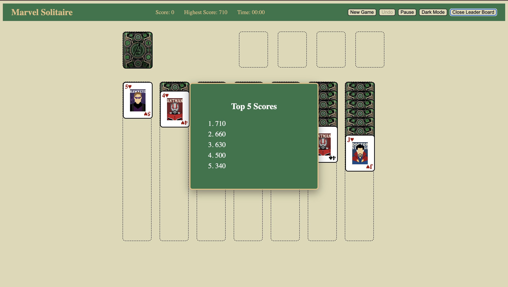

# Marvel Solitaire Card Game
## Technologies Used
1. HTML
2. CSS
3. JavaScript

# Description
A Marvel-themed take on classic Klondike Solitaire. The goal of the game is to move all 52 cards to the four foundation piles, building each suit up from Ace to King. The main rule is to build the piles on the tableau in descending order and in alteraning colors (black and red).

## User Stories
- The user should see a shuffled deck dealt at the start of the game
- The user should draw a card
- The user should recycle the stock
- The user should select a card
- The user should move a card to the tableau if it's legal
- The user should reveal the hidden cards
- The user should see a message if they win 
- The user should be able to restart the game
- The user should be able to see a timer
- The user should be able to pause the game
- The user should be able to drag/drop the cards
- The user should be able to see their score and high score
- The user should be able to see a leaderboard
- The user should be able to toggle between dark and light mode

## Screenshots
Light Mode of the game: 

Dark Mode of the game:

Pause PopUp:

Winning Popup:

Leader Board PopUp:

## Future Enhancements
- Add a hints button
- Add an algorithm that detects a loss automatically
- Add difficulty levels
- Add more animation to make it more interactive

## Credits
[W3Schools](https://www.w3schools.com)